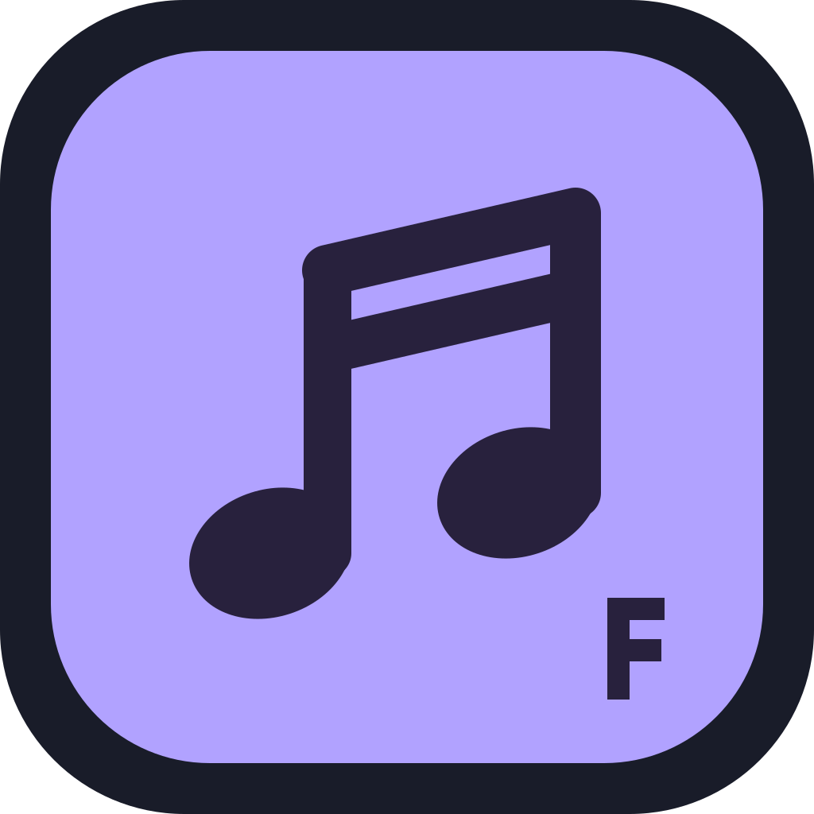

# Discordアクティビティの使い方

Discordデスクトップ版を起動すると、Favecus Playerで再生している曲をアクティビティに表示できます。Discord本体のアクティビティ共有も有効にしてください。

## 初回の設定

1. [Discord Developer Portal](https://discord.com/developers/applications)で自分のApplicationを作成するか、使用するものを開きます。
2. **General Information → Application ID** をコピーします。
3. Favecus Playerの **設定 → Discordアクティビティ** を開き、Application IDへ貼り付けます。
4. **Discordに再生中の内容を表示する** をオンにします。
5. 次の手順で共通アイコンを登録し、**保存して戻る** を押します。

Bot TokenやClient Secretの入力は不要です。Web版のDiscordだけでは接続できません。

## 共通アイコンを登録する

1. Favecus Playerの設定で **登録するPNGを表示** を押します。使う画像は **favecus_player_music.png** です。
2. Developer Portalで、同じApplication IDのアプリを開きます。
3. **Rich Presence → Art Assets** でPNGを追加します。
4. 画像名・Asset Keyを **favecus_player_music** にします。拡張子は付けません。
5. Favecus Playerの **Rich Presenceの画像名** も **favecus_player_music** にします。独自の名前を使う場合は、両方を一致させます。
6. 保存後、曲を再生して接続状態を確認します。

General InformationのApp Iconと、アクティビティの画像登録は別です。画像が出ない場合はApplication IDとAsset Keyの一致を確認してください。画像登録の反映には時間がかかる場合があります。再生状態の送信は間隔をまとめるため、設定反映まで最大約15秒待つ場合があります。

## 楽曲画像の大きさとリンク

**楽曲のサムネイルを表示** をオンにすると、Bilibiliの公開画像を表示します。**楽曲アイコンのサイズ** で次を選べます。

| 設定 | 大きい画像 | 補助画像 |
| --- | --- | --- |
| 小：補助画像 | 共通アプリアイコン | 楽曲サムネイル |
| 大：メイン画像 | 楽曲サムネイル | 共通アプリアイコン |

アプリに登録したアイコンそのものは変更しません。補助画像の位置と実際の大きさはDiscordが決めます。四隅への自由配置、ピクセル単位のサイズ、カード背景全体への配置には対応していません。

**楽曲アイコンを押すと動画を開く** をオンにすると、楽曲画像だけへ選択中のパートの動画リンクを設定します。曲名と共通アプリアイコンには動画リンクを設定しません。オフにすると楽曲画像からのリンクも外します。画像非表示の場合はリンクを付けません。

Discordがアプリ名から開くアプリ情報や、外部リンクを開くときの確認画面はDiscord側の動作です。Favecus Playerから確認画面の有無を指定することはできません。ローカルファイルのパスやログイン情報はアクティビティへ送りません。

## 一時停止中の表示

**一時停止中はアクティビティを非表示** をオンにすると、一時停止中の活動表示を消します。

オフにすると、例えば **一時停止 · 02:56 / 05:11 · Bilibili** と表示します。左が停止位置、右が総再生時間です。一時停止中はこの数値を進めず、再生再開時に時間バーへ戻します。表示の省略や配置はDiscordクライアントにより異なります。
